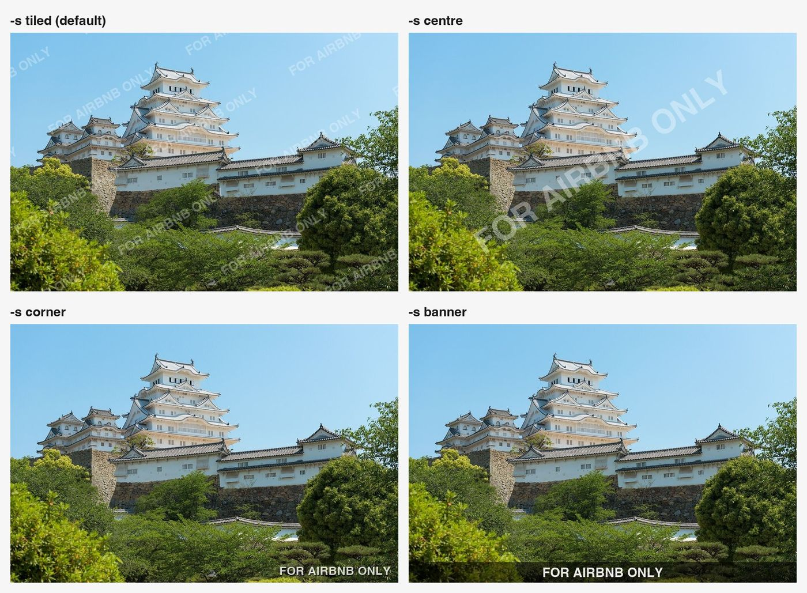
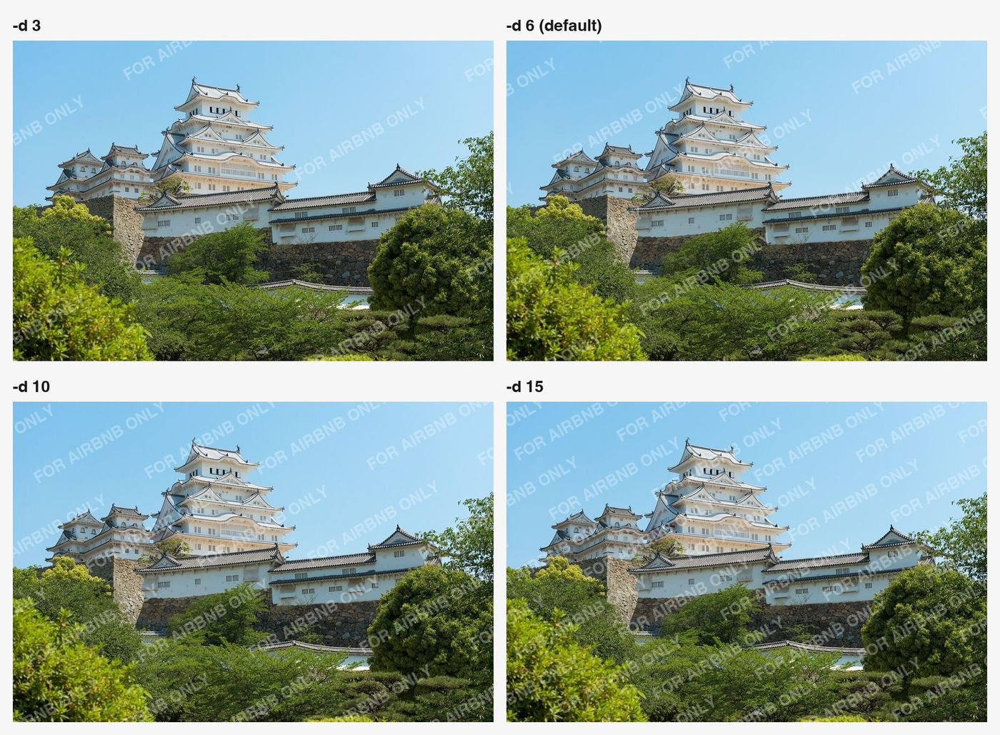

# watermarker

[](https://github.com/jrts/watermarker/actions/workflows/test.yml)

Adds a text watermark to JPEG (and PNG) photos. Originals are never changed.

Built for marking photos and ID scans before uploading them somewhere — a
repeated diagonal watermark is hard to crop or edit out.

- **Text only** — any language, but no emoji and no logo images
- Four styles: **tiled** diagonal lines (default), **centre**, **corner**, **banner**
- Batch: pass a folder and every JPEG/PNG in it is processed
- Optional resize: width, height, or both
- Removes location and camera data, keeps the colour profile, fixes phone rotation



## Install

You need **Python 3.9 or newer** and one library, **[Pillow](https://python-pillow.org/)**.
Check your Python with `python3 --version`.

### 1. Get the code

```sh
git clone https://github.com/jrts/watermarker.git
cd watermarker
```

### 2. Install Pillow

**Recommended: a virtual environment**, so Pillow stays inside this folder and
nothing is installed system-wide.

macOS / Linux:

```sh
python3 -m venv .venv
source .venv/bin/activate
pip install -r requirements.txt
```

Windows (PowerShell):

```powershell
py -m venv .venv
.venv\Scripts\Activate.ps1
pip install -r requirements.txt
```

Each time you open a new terminal, activate it again with
`source .venv/bin/activate` (or `.venv\Scripts\Activate.ps1` on Windows).
`deactivate` leaves it.

**Or without a virtual environment:**

```sh
python3 -m pip install --user "pillow>=10.1"
```

On recent macOS and Linux this may refuse with *externally-managed-environment*
— use the virtual environment instead.

### 3. Check it works

```sh
python watermark.py --help
```

If you see `Pillow is missing`, the environment is not active, or step 2 did
not run.

### Optional: run it from anywhere

Add an alias to `~/.zshrc` or `~/.bashrc`, pointing at your copy:

```sh
alias watermark='/path/to/watermarker/.venv/bin/python /path/to/watermarker/watermark.py'
```

Then `watermark photo.jpg -t "FOR AIRBNB ONLY"` works in any folder, without
activating anything.

## Run it

```sh
python watermark.py photo.jpg --text "FOR AIRBNB ONLY"
python watermark.py ~/Pictures/airbnb/ --text "FOR AIRBNB ONLY"      # a whole folder
```

Output goes to a `watermarked/` folder beside each photo, named `<name>_wm.jpg`.
Folders are read one level deep (not subfolders). Other files are skipped.

## Options

| Option | What it does | Default |
|---|---|---|
| `-t, --text` | The watermark text. **Required.** Text only — emoji are refused, as they would print as empty boxes | — |
| `-s, --style` | `tiled`, `centre`, `corner`, `banner` | `tiled` |
| `-d, --density` | Tiled only: **number of lines of text** across the photo, 1–30 | `6` |
| `-o, --opacity` | 0.05–1.0 | tiled 0.28, centre 0.35, corner 0.8, banner 0.9 |
| `--size` | Text height as a fraction of the photo's short side | 0.045–0.05 |
| `--angle` | Degrees | tiled 30, centre follows the diagonal |
| `--color` | `white`, `black`, `red` | `white` |
| `-W, --width` | Output width in px | original |
| `-H, --height` | Output height in px | original |
| `--out` | Output folder | `watermarked/` beside each photo |
| `--suffix` | Added to the filename | `_wm` |
| `--quality` | JPEG quality | 92 |

**Density** is the number of lines of text across the photo, for the tiled style:



**Resizing:** give neither and the size is unchanged. Give one of `--width` or
`--height` and the other follows the photo's proportions. Give both and the
photo is stretched to exactly that size. Resizing happens before the
watermark goes on, so the text is sized for the final image.

**White on white:** the default text is white, which disappears on white
paper. Use `--color black` for scans of documents.

**Privacy:** location is removed. Each output is a fresh image, so nothing
from the original's metadata comes across — no EXIF (GPS, camera make and
model, date taken), no XMP, no comments. The one thing kept is the **colour
profile**, which holds no personal data and stops iPhone photos looking dull.
Phone photos are turned the right way up before the metadata is dropped.
The tests check this on every change.

## Examples

```sh
# A passport photo, 10 lines of text, dated
python watermark.py ~/Desktop/passport.jpg -t "FOR AIRBNB ONLY 14 OCT 2026" -d 10

# A whole folder, corner stamp, 1600 px wide
python watermark.py ~/Pictures/flat/ -t "MY FLAT" -s corner -W 1600

# Exactly 1080 x 1080 (stretched)
python watermark.py photo.jpg -t "FOR AIRBNB ONLY" -W 1080 -H 1080
```

## Tests

```sh
pip install -r requirements-dev.txt
python -m pytest
```

The tests make their own images, so they need no sample photos. They cover
every style, the line count for `--density`, all resize modes, phone
rotation, removal of GPS/EXIF/XMP, the colour profile, transparent PNGs,
folders, and bad options. GitHub Actions runs them on macOS, Linux and
Windows, with Python 3.9 and 3.13, on every push.

## Licence

The code is MIT — see [LICENSE](LICENSE).

The example images in `docs/` are made with this tool from
[Himeji castle in may 2015](https://commons.wikimedia.org/wiki/File:Himeji_castle_in_may_2015.jpg)
by Nikos Kitsakis, licensed
[CC BY-SA 4.0](https://creativecommons.org/licenses/by-sa/4.0/). They were
resized and watermarked, and are shared under the same licence.
